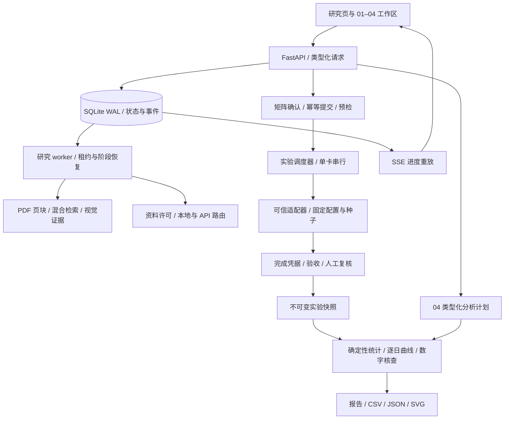

> 文档状态：当前。更新于 2026-09-22。首版架构已归档至 `archive/ARCHITECTURE.md`。

# 当前架构与代码导航

本地单用户科研工作台：浏览器调用 FastAPI；研究任务和实验任务由不同执行器处理；SQLite WAL 保存状态和事件；本地模型与训练共享协作式 GPU 锁。拆分本机进程不代表多机高可用。

| 模块 | 主要文件（`loom/`） | 责任 |
|---|---|---|
| 接口与存储 | `api.py`、`workspace_api.py`、`store.py`、`schemas.py` | 请求契约、持久状态、原文/事件/结果 |
| 论文理解 | `documents.py`、`retrieval.py`、`engine.py`、`verification.py` | 页块坐标、BGE-M3/BM25/RRF、图文阅读、摘录核查 |
| 模型执行 | `model.py`、`routing.py`、`execution.py`、`gpu.py` | Transformers 推理、权限、API、调用账本与 GPU 锁 |
| 研究任务 | `worker.py`、`worker_main.py` | 租约、checkpoint、取消、累计预算与恢复 |
| 文献与初稿 | `workspace.py`、`audit.py` | 版本化元数据、引用位置、评分与数字核查 |
| 实验定义 | `register_trainer.py`、`experiments.py`、`experiment_design.py`、`batch_experiments.py` | 可信清单、分组参数、矩阵、冻结协议、提交去重 |
| 实验执行 | `preflight.py`、`lab_worker.py`、`trial_runner.py`、`training.py` | 预检、派发、独立训练、进度和日志 |
| 产物验收 | `artifact_finalization.py` | 完成凭据、哈希、指标和不重训复核 |
| 数据分析 | `platform.py`、`research_data.py` | 受限 DSL、筛选、逐日统计、可比性、图表 |
| 评测与导出 | `evaluation.py`、`observability.py`、`export.py` | 质量框架、执行观测与交付 |

03 不调用模型。`adaptive_controller.py`、`experiment_assistant.py` 中历史控制器与建议式流程仅保留兼容，不能由源码仍存在推断当前入口开放。

已记录的模型响应可以回放；落盘前崩溃可能结果未知。实验进程死亡不隐式重训；恢复剩余矩阵不同于恢复模型 checkpoint。当前没有 DDP、分布式数据库、多机调度或训练沙箱。

训练工程由用户在本地单独提供（不在本仓库内），以可信清单和 `TrainingContext` 接入。算法、平台、数据、配置分别记录版本。平台不从 PDF 自动编写可信训练程序，也不保证任意实验不存在数据泄漏。

最新事实和边界见 [能力矩阵](CURRENT_STATUS.md)、[工程补强](ENGINEERING_HARDENING_20260922.md)。
