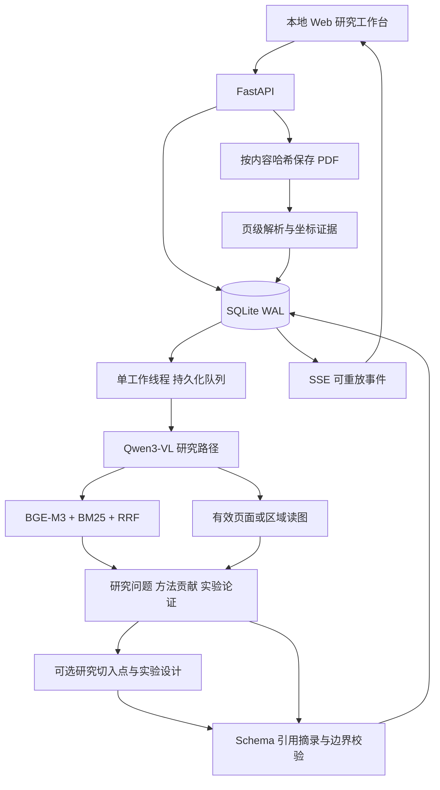

> 文档状态：历史架构快照（归档）。当前能力与上传语义以 `CURRENT_STATUS.md`、`RELIABILITY_OPERATIONS.md` 为准。

# 研途：第一版架构与边界

本文记录 2026-09-11 的首版架构，后面的单进程与重试描述属于历史状态。2026-09-14 的 0.2 执行层已经改为可拆分 API/worker、事务入队、租约、累计调用预算与调用账本，当前运行合同以 [RELIABILITY_OPERATIONS.md](../RELIABILITY_OPERATIONS.md) 为准。研究理解、证据身份与研究方案定位仍沿用本文件。

本项目实现的是围绕本地论文的研究理解与规划。它服务于 AI 各方向的研究生，指标用于理解作者如何论证成果，图像用于理解方法架构与实验趋势。

## 核心数据流

UI 不展示隐式思维链。进度仅包含规划摘要、所用工具/步骤、用量和状态。

## 资料身份与语义身份

`paper.id` 基于 PDF 哈希，`evidence.id` 基于论文、页、块；原文不可被模型修改。正文证据保留 bbox 与解析器版本，视觉观察另存 `kind=visual` 并带生成模型、Prompt 版本和 run_id。

`Finding` 的 category 覆盖研究问题、方法、贡献、指标、数据集、基线、消融、限制与图。`basis` 与 `source_status` 分开：模型推断即使引用摘录完全匹配也仍是推断；模型看图生成的文字即使被下一阶段引用，也不会升级为作者原文。

论文观察位于 `statement`，对用户研究的启发位于 `research_implication`。模型结论复核单独保存在 `model_review`，与确定性摘录检查并列展示；使用同一模型，不构成独立验证。缺失性断言、视觉来源和资源适配强结论还会触发规则提示，但规则不是完整语义判定器。

`Direction` 独立于论文事实，包含改动、成立假设、可证伪实验与检索式。任何方向的新颖性都不自动认证。人工复核只追加记录，不覆盖原始结果或自动更改其作者/模型来源类型。

方案可行性复核检查动机依据、资源断言、假设与否定条件、潜在算法退化和重复工作。结果也来自同一模型，作为辅助审查单独展示，不能代替专家判断或实际试跑。出现“建议先修改”的方向仍保留原始输出，用户可据此补充约束或继续追问。

## 任务状态

当前 Prompt 版本为 `research-planning-v4`。`Experiment.relation` 明确 candidate、reference、metric、metric_direction、expectation 和 condition；确定性编译器据此生成假设及相应否定条件，保留 `model_draft_hypothesis` / `model_draft_falsification` 供追溯。探索性关系明确标记尚无方向性假设。阈值和正式评测协议需要预实验后冻结，不由模型捏造一个百分比。这里的编译仅保证语言关系对应，不能判断指标定义、多个指标方向是否冲突，或实验是否科学有效。

`queued → running → completed / failed / cancelled`。失败/取消可显式重试；重试保留已完成阶段，并重新给予有界的调用额度。服务中断后的 running 任务回到 queued，已有 checkpoint 与页事务被复用。

同一工作队列处理上传解析和研究任务，保证单模型不会同时生成；代价是长研究任务期间新的解析任务也可能排队。第一版明确采用单用户、本机、单服务进程形态。若以后需要多进程，必须实现数据库租约和独立推理服务，不能简单增加 uvicorn workers。

## 第一版保护措施

- 上传只接受可读取的 PDF，并限制大小、页数和加密文件。当前入口采用内存有界的临时磁盘缓冲，不是零拷贝直通；详见当前运行说明。
- 磁盘文件名由哈希产生，客户端文件名仅作展示。
- 工具页码、论文范围与 bbox 经过校验；前端以转义文本显示模型和论文内容。
- 修改请求校验 Origin，服务只监听 loopback。
- 所有 SQL 是后端固定语句和绑定参数，模型没有数据库写入、shell 或任意 Python 执行工具。
- 模型上下文和生成长度有上限；每次研究的模型调用数受服务端限制。

提示注入防护在本版本主要由“无危险工具 + 范围校验 + 资料边界提示 + 结果标记”组成，不能宣称已经抵御所有语义层注入。质量与安全评测仍需进一步扩展。

## 当前尚未实现

- 外部文献检索和新颖性检索闭环。
- 自动精确定位所有论文插图；目前是模型选页与用户选择整页/上下区域，引用正文块支持 bbox 高亮。
- 图像表征向量检索、公式语义求解、复杂跨页表结构恢复。
- 多用户身份、权限、多进程 GPU 服务与高可用集群。
- 独立语义蕴含核验器、跨领域冻结金标评测和发表效果验证。

这些限制应在项目介绍中如实保留。第一版的价值在于图文研究与实验规划的真实可运行链路和可追溯工程基础。
