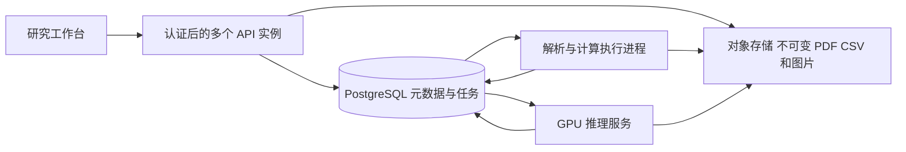

> 文档状态：历史需求规划（归档）。已实现状态以 `CURRENT_STATUS.md` 为准。

# 从论文问答到持续研究工作台：需求、工程与 Data Agent

日期：2026-09-14。本文结合用户修正后的定位、现有 Research Loom、旧建议第 8 节，以及 `工程化/ai-execution-reliability.html` 制定。旧建议把论文性能数值分析作为主线的部分已被用户否定，不再沿用。本次实现的是执行可靠性；本文件的新增业务模块属于设计，不能当作已交付功能。

## 1. 对算法工程师建议的判断

认可其核心：真实业务约束越多，越容易出现值得讨论的架构取舍。需要补充：需求复杂度、模型不确定性和分布式复杂度是三个维度。重复模型调用可能改变决定，单进程也会遇到；多个进程争抢任务、响应丢失、旧进程晚返回则引入执行一致性问题。增加服务器不会自动改善研究建议质量。

当前“上传一篇 PDF → 一轮分析 → 结束”确实偏短。建议将产品定位扩展为：**面向 AI 研究生、贯穿读文献—形成假设—设计实验—核对初稿的可追溯研究工作台**。主线继续覆盖人工智能应用、强化学习、大模型方法等领域，研究阅读继续关注方法机制、指标选择、基线和消融。

复杂性来自一个真实目标：研究工作持续数周，有多篇文献、反复修订的计划、多个实验批次和论文初稿版本。用户需要知道某项结论“来自哪一版资料、经过什么验证、之后有没有失效”，而不仅是获得一段回答。

## 2. 一条值得实现的完整需求

示例：研究生围绕一个研究问题上传多篇论文；整理各文的研究假设、方法机制、实验协议和评价指标；形成两个候选方向；确认一个实验计划；导入自己跑出的 CSV；上传初稿 v1；核查初稿与实验记录是否一致；修订 CSV 或初稿后，只重算受影响的检查。

| 真实需求 | 必须作出的工程决策 | 可以验收的行为 |
|---|---|---|
| 一次研究涉及多篇论文，部分解析失败 | 子任务身份、独立检查点、部分完成策略 | 失败一篇不重跑已完成论文；研究报告说明覆盖范围 |
| 同一任务等待 GPU，但用户仍要查历史 | API 与执行进程分离、背压、持久队列 | API 可用性和模型任务耗时分别观察 |
| 模型回答后服务崩溃 | 回答落盘边界、尝试身份、未知状态 | 已记录回答复用；未记录回答可能重新调用，不能声称零重复 |
| 实验计划被人工确认后又有新建议 | 不可变计划修订、确认绑定 revision | 新建议建立新修订，不改写旧计划 |
| 数据改了，旧初稿检查可能过期 | 数据快照、依赖图、增量失效 | 能列出哪些结论需重算，以及受影响的输入 |
| 初稿核查缺少原始值或计算定义 | 暂停澄清、结构化补充、到期策略 | 保留“无法判定”，收到信息后从该步骤继续 |
| 多人共享课题，部分未发表资料私密 | workspace 身份、授权、审计 | 文档、查询、SSE、导出全部验证所属项目 |

本次仅实现了上述执行层的一部分。多篇任务 DAG、计划确认、增量依赖和多人项目均未实现；它们有明确业务理由，后续按阶段落地。

## 3. 新增子板块：实验数据与初稿核查

建议在现有“文献理解与研究规划”旁边新增 **“实验数据与初稿核查”**。共享项目、文档身份、证据定位和可靠执行底座；使用独立的结构化数据模型与任务类型，不改变原有研究阅读的目标。

这里自然包含两种入口：

- **Data Agent：**从用户问题制定核查计划，查找初稿和实验数据，必要时澄清单位、条件、分母或汇总规则，调用受控计算工具，追踪失败并生成核查报告。
- **ChatBI：**围绕已经建模的实验数据、检查记录和文献属性，进行自然语言筛选、分组、统计和可视化。

“把论文思路存入数据库再总结”本身主要属于检索与知识管理，不能仅因底层用了数据库就算深度 ChatBI。要形成明确的分析对象、可执行查询、可检验答案及计算来源。

### 输入与可证明范围

1. 只有初稿 PDF：能检查文内数字、公式和口径的一致性，不能证明实验数据真实。
2. 初稿 PDF + 实验 CSV/JSON：能核对初稿与提供的数据是否一致，仍不能证明数据没有造假或实验已正确实施。
3. 再提供实验配置、数据集版本和运行记录：才能进一步检查跨表实验身份、随机种子、数据划分等；自动训练与完整复现仍是另一项能力。

优先支持 CSV/JSON 加 PDF。PDF 保留为初稿与引文输入；表格截图通过 Qwen3-VL 辅助读取，但模型读出的值必须保留“待确认”身份。对于没有数值标注的曲线，不用估读小数参与精确校验。

### 第一批值得做的核查

| 用户问题 | 程序检查 | 必须明确的前提 |
|---|---|---|
| 表里的三个子项之和等于总项吗？ | 使用 Decimal 按显式规则求和，核对总项 | 子项可加、互不重叠、覆盖总项，单位及时间范围一致 |
| 正文写提升 12%，与表里的值一致吗？ | 按确认的基线与分母复算相对变化 | 区分绝对差、相对变化、百分点；基线不为零 |
| 表 2 和表 4 的同一个实验结果为何不同？ | 对齐实验 ID、方法修订、数据划分、seed 集合、指标定义 | 不能只按同名方法匹配 |
| 原始 CSV 的均值与初稿一致吗？ | 按实验粒度聚合，区分总体/样本统计及加权方式 | 确认重复记录、缺失值处理和统计对象 |
| 哪些结论还缺支撑？ | 查询核查状态和血缘缺口，列出未确认数字、缺分母与过期检查 | 缺少支持不等于结论已被证明错误 |

总分项检查不能直接把“名字像能耗的列”全部相加。例如制冷能耗可能已包含在电网能耗中；直接相加会重复计算。规则应由定义证据与用户确认建立，模型只能提出候选关系。

舍入也必须建模。例如显示值 `12.3 + 8.4` 与显示总数 `20.8` 不相等，但若三者均四舍五入到一位小数，真实子项和的可能区间与真实总项区间存在交集。此时应标“与舍入误差相容”，不能直接判数据错误。相容也不代表证实正确。

推荐核查状态：`consistent / inconsistent / rounding_compatible / not_verifiable`。同时单独保存原始值是否人工确认；计算通过不能自动把 OCR/VLM 提取升级为原文事实。

### 更有价值的 ChatBI 问题

- “当前课题中，哪些初稿结论仍然引用旧实验批次？按章节统计，并列出对应数据修订。”
- “在我自己相同配置的实验中，各方法完成了几个随机种子，哪些缺少消融或运行记录？”
- “按数据集和评测协议整理已读论文采用的评价指标；哪些字段只是模型推断？”
- “本轮数据修订影响了哪些总分项检查和正文提升比例？只显示需要重新审核的结论。”

这些问题的主表分别是版本、实验记录、文献属性和核查结果。不能把不同论文的性能数值不加条件地汇总排名。若只查询所收集文献，也不能把结果解释为整个研究领域的普遍趋势。

## 4. 数据模型与执行边界

新增模块至少需要以下对象；不是在现有 `papers` 表上加一个 summary 字段即可。

| 对象 | 身份与关键约束 |
|---|---|
| ResearchProject / ProjectRevision | 研究目标、成员、不可变修订及当前工作版本 |
| SourceAsset / DatasetSnapshot | PDF/CSV 原文件哈希、解析版本、快照时间、上游来源 |
| ExperimentRun | 方法修订、配置哈希、数据划分、seed、运行记录 |
| MetricDefinition | 名称、单位、方向、统计方式、分母、可加性和定义证据 |
| Observation | 实验 × 方法 × 指标 × 条件 × seed；原始文本、Decimal 值、精度与来源 |
| DraftClaim / DraftRevision | 章节、表格单元格、正文陈述及其初稿版本 |
| AuditRule / AuditFinding | 规则版本、参与记录、计算表达式、舍入策略、结果与原因 |
| AnalysisRun / CalculationLineage | 问题、快照、类型化查询、编译 SQL/函数参数、输入行 ID 和结果 |
| ReviewDecision | 审核对象及修订、决定、接收时间、稳定事件 ID |

第一版分析让模型生成受约束的 `AnalysisSpec`，例如实体、过滤、分组、指标与操作。后端做类型检查并编译参数化 SQL，复杂计算调用固定函数。SQL 只读、限制结果行数和执行时间；不给模型任意 shell、Python 执行或文件访问能力。

不要把“查询观察值，再 JOIN 每条观察的多个证据”直接 SUM，否则一对多关联会重复计数。先在事实粒度聚合，再关联证据；SQL 输出必须能定位到参与计算的原始行。

元数据事实源先保持单一；当数据量和分析查询确有需要时，可从不可变数据快照生成 DuckDB 分析文件。计算结果绑定快照，不让正在更新的数据悄悄改变一次核查的输入。是否使用 DuckDB 是可替换的执行层选择，不是 ChatBI 的定义条件。

## 5. 分布式如何成为合理需求

本次已实现同主机多个 API 进程和独立执行进程；支持事务抢任务、租约、心跳与过期写入拦截。这能在个人电脑上验证一部分跨进程一致性问题，**不能称为已部署多机分布式集群**。

多机的真实触发条件包括：多人共享未发表资料；解析、分析和 GPU 工作需要独立扩容；一台执行机器退出后希望另一台继续；任务输入和人工审核跨天存在。此时可采用：

SQLite WAL 要求相关进程位于同一台主机，不应把本地数据库文件放到网络共享盘冒充多机数据库。[SQLite 官方说明](https://www.sqlite.org/wal.html)

真正迁移时，需要服务端数据库事务与约束、对象存储、身份授权、GPU 服务请求身份、跨服务追踪和恢复部署。消息队列可以用于唤醒，但若同时写业务表和发消息，需要事务 outbox 等机制；消费仍按幂等键去重。当前 SQLite 任务表本身承担队列事实源，避免了双写问题。

Temporal 等持久执行服务值得作为未来选项，尤其是大量长时等待、人工消息和复杂父子任务；不要仅为一个技术名词迁移。它们也不能替业务定义幂等范围、指标含义或模型输出是否正确。当前实现不是 Temporal，也不是 LangGraph。

## 6. 与工程师 HTML 中 12 类问题的对应

| 材料主题 | 本次落地 | 当前边界 |
|---|---|---|
| 1 有状态但无人继续 | worker 轮询、租约过期接管、独立监督启动选项 | 仍需要存活的监督器/worker，数据库自己不会执行任务 |
| 2 重试时点和预算丢失 | not_before、总期限、累计调用预算和恢复上限 | 当前本地模型没有 HTTP Retry-After 适配器 |
| 3 模型回答未记录 | 原始回答账本、已记录回答回放、未知调用记录 | 未落盘前仍可能重复调用 |
| 4 进程活着但工具卡住 | 停滞检测、停止续租；独立 worker 退出释放资源 | 嵌入式模式不强杀 API；监督进程/整机故障由部署系统负责 |
| 5 输入确认丢失 | 研究提交幂等键、原子入队，响应丢失测试 | 跨天业务审批通道尚未实现 |
| 6 外部写入成功但超时 | 以本地提交响应丢失验证接收端原子去重 | 尚无真实外部写入，不声称外部效果 exactly-once |
| 7 截止跨重启 | 绝对任务 deadline 保留 | 不是人工审批有效期政策 |
| 8 部分分支失败 | 已有阶段、分页 checkpoint | 多篇任务 DAG 与汇聚策略未实现 |
| 9 子任务交接与补偿 | 当前任务取消及迟到结果拦截 | 父子业务任务、补偿未实现 |
| 10 历史膨胀 | 请求统计只保留近 1000 条耗时；查询分页 | 持久事件/原始模型账本尚无归档轮换，需监控磁盘 |
| 11 运行中升级 | Prompt 版本不匹配时明确拒绝混用 | 未实现多版本 worker 路由或自动迁移 |
| 12 成功但证据不完整 | run/epoch/attempt/input_hash、原始输入输出、原子终态事件 | 历史任务无法补造过去未记录的输入与费用 |

## 7. 推荐实施顺序和验收

1. **已交付：执行可靠性基础。** 用故障实验和真实本地模型确认恢复边界，保留可复跑脚本、结果及局限。
2. **下一业务增量：初稿数据核查。** PDF + CSV；一个课题；总分项、正文比例、同实验跨表一致性；用户确认规则后执行；全部结果有行级来源。先用人工构造错误与真实手工核对样例验收，不承诺自动审核整篇论文。
3. **自然语言分析入口。** 固定一组问题，验证 `AnalysisSpec` 是否选对数据、粒度和公式，输出可执行查询与图表；再扩展多表问题和必要澄清。
4. **长周期研究项目。** 加版本冻结、审核决定、依赖失效和局部重算；随后根据实际共享需求加入身份与项目授权。
5. **多机部署。** 迁移数据库和工件存储，分离 CPU/GPU 池，测试机器退出、重复投递、网络隔离和授权；应在第 2–4 步产生真实需求后实施。

新增模块评测至少分别报告：提取错误、规则识别错误、计算错误、来源错误、应拒绝却通过、正常舍入被误报，以及对缺失数据的澄清能力。不要用“SQL 执行成功率”代替回答正确率；拒绝率和覆盖率要与准确率一起报告。

## 8. 项目陈述口径

当前可以说明：“将本地多模态研究 Agent 的 API 与执行进程分离，实现持久队列、幂等提交、租约与过期提交隔离、模型调用账本；通过进程强制退出、不同重试回答、响应丢失与并发提交实验验证执行语义。”性能数字须同时写明端点、同机环境、并发度、持续时间和未调用 GPU。

新增模块实现后才可以说“初稿数据核查 Data Agent / 实验数据 ChatBI”。目前不能写“已支持多人分布式科研平台”“高 QPS 模型推理”或“自动保证论文数据与创新正确”。有边界、有失败案例、有可复现证据，比扩大承诺更能经得起追问。
